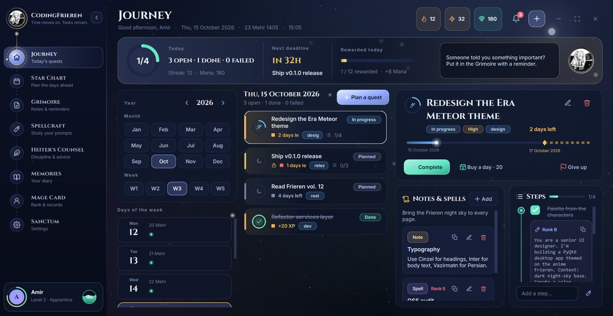
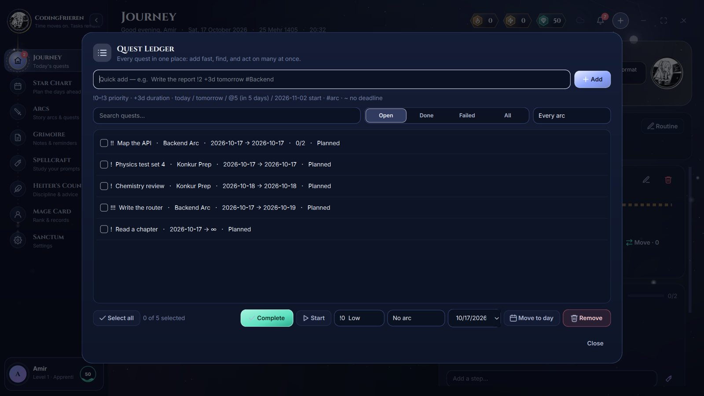
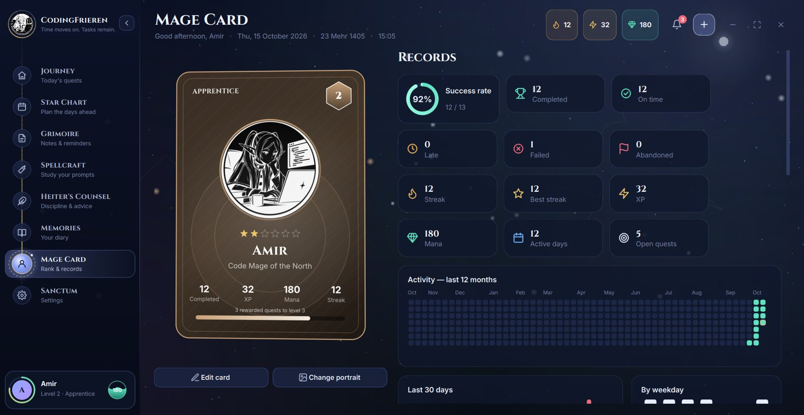
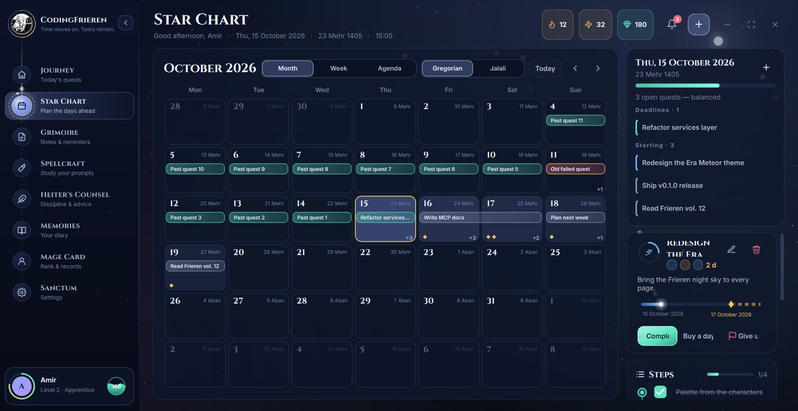
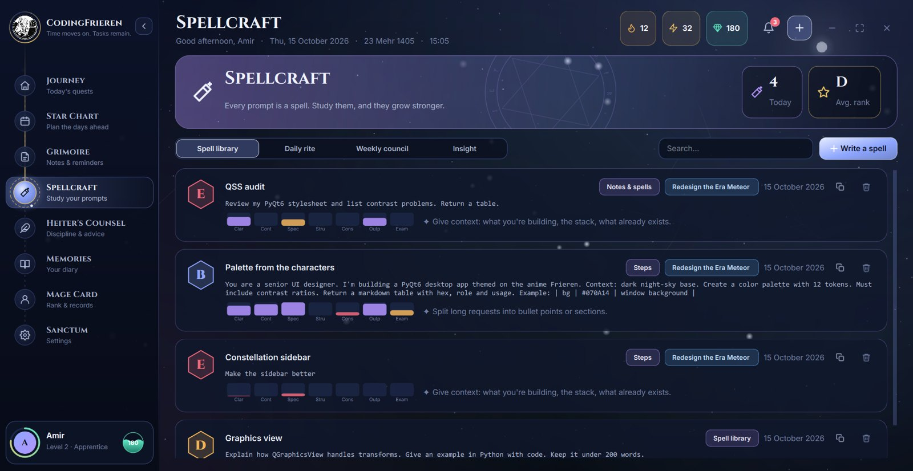
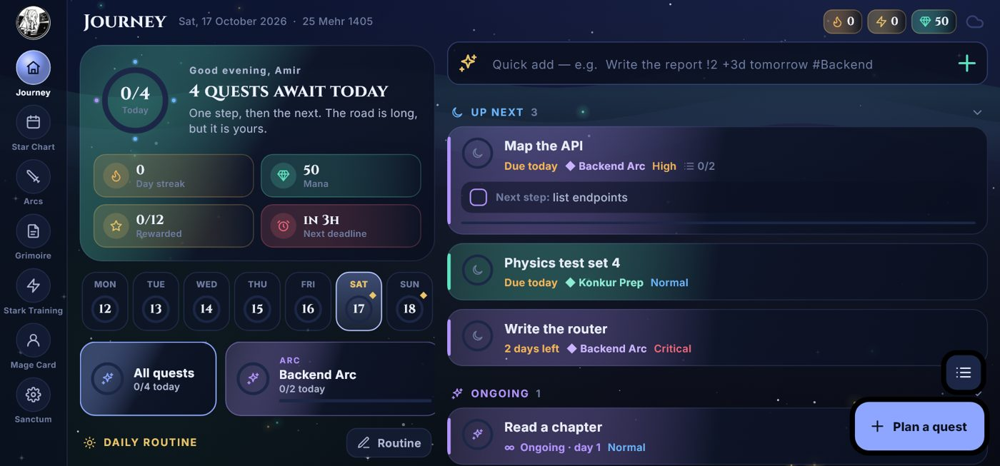
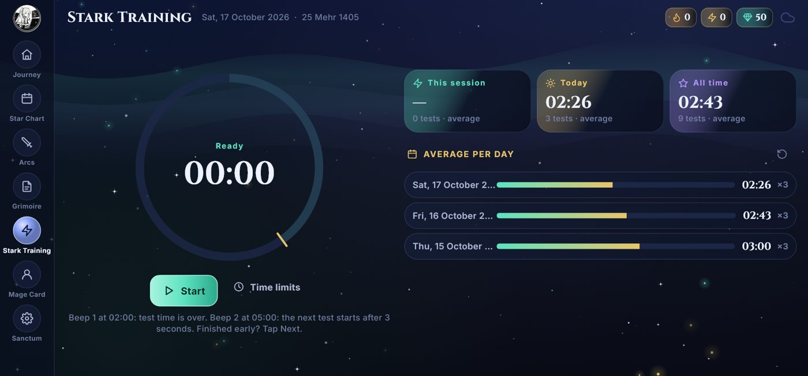

<p align="center">
  
</p>

<h1 align="center">CodingFrieren</h1>

<p align="center"><b>Time moves on. Tasks remain.</b><br>
Master your time, embrace the journey, and go beyond the ordinary — a gamified quest log for Windows and Android,<br>
set on the night of the Era Meteor Shower and guided by Frieren.</p>

<p align="center">
  <a href="https://github.com/AmirItachi82/CodeFrieren/releases/latest"></a>
  <a href="https://github.com/AmirItachi82/CodeFrieren/releases"></a>
  <a href="https://github.com/AmirItachi82/CodeFrieren/stargazers"></a>
</p>

<p align="center">
  <a href="https://github.com/AmirItachi82/CodeFrieren/releases/latest"><b>⬇ Windows installer</b></a> ·
  <a href="https://github.com/AmirItachi82/CodeFrieren/releases/latest"><b>⬇ Windows portable (one .exe)</b></a> ·
  <a href="https://github.com/AmirItachi82/CodeFrieren/releases/latest"><b>⬇ Android APK</b></a>
</p>



---

CodingFrieren turns your work into **quests**. Plan each one honestly with a maximum number of days, finish it on
time and earn **XP** and **Mana**. Miss it and it fails. Your **Mage Card** evolves through **60 levels and 10 ranks**,
from *Apprentice* to *Thousand-Year Elf*. Your prompts are **spells**: CodingFrieren collects them, ranks them instantly
and runs daily and weekly reviews with Claude, so your prompt-writing visibly improves.

Everything syncs between your PC and your phone. Sign in once — that's it.

## ✦ What's inside

| | |
|---|---|
| 🗺️ **Journey** | Today at a glance: a glowing ring of the day's quests, streak, Mana, the next deadline, a seven-day ribbon, arcs and your daily routine |
| 📜 **Quest Ledger** | Every quest in one list: search, filter, tick many and complete / move / re-prioritise them at once. **Quick add** in one line: `Write the report !2 +3d tomorrow #Backend` |
| ⭐ **Star Chart** | Month view, week Gantt with a live *now* line, agenda by urgency — Gregorian **and** Jalali |
| ⚔️ **Arcs** | Story arcs that group one goal's quests; import a whole plan from JSON |
| 📖 **Grimoire** | Notes with colored inks, pins and reminders |
| 🪄 **Spellcraft** | Your prompt library, ranked S–E, with reviews written by Claude |
| ⚡ **Stark Training** *(Android)* | A stopwatch for timed practice tests: 2 min to solve, analysis up to 5 min, two distinct beeps, auto-next after a 3-second countdown, pause/resume, and your average per day |
| 🔔 **Heralds** | Beautiful notifications with their own epic sounds — a rune card on the desktop, real system notifications on Android, even when the app is closed |
| 🎵 **Music** | Frieren's theme on start, plus calm fantasy pieces (harp, flute, choir, celesta) that loop softly while you work |
| 🤖 **Claude Code (MCP)** | Let Claude plan your week, split a quest into steps with spells, or run your reviews: `CodingFrieren.exe --mcp` |

<p align="center">
  
  
</p>
<p align="center">
  
  
</p>

### On Android

<p align="center">
  
  
</p>

## ⬇ Install

**Windows 10/11**
- **Installer** — `CodingFrieren-Setup-<version>.exe`: no admin rights needed, adds a Start-menu and desktop shortcut and a normal uninstaller.
- **Portable** — `CodingFrieren-<version>-portable.exe`: one file. Put it anywhere (a USB stick too) and run it.

**Android 7+** — `CodingFrieren-<version>-arm64-v8a.apk` fits almost every phone (`armeabi-v7a` for older ones, or the
universal `CodingFrieren-<version>.apk`). Allow installing from your browser when Android asks.

**Updates install themselves**, on both platforms, and never touch your data: the app checks this page, backs up your
journey, swaps itself and restarts.

## 🔒 Your data

- Everything works offline; a local database per account with daily backups and a backup before every update.
- Sync is *download first, then upload* (like `git pull` before `push`); edits to different fields merge, and if the same
  field changed on two devices you choose which to keep.
- Each account can only ever read its own rows (Row Level Security on the server). The app carries only a public key.

## 🤖 Connect Claude Code

```bash
claude mcp add --scope user codingfrieren -- "%LOCALAPPDATA%\Programs\CodingFrieren\CodingFrieren.exe" --mcp
```

Then ask: *"plan my week in CodingFrieren"*, *"break the README quest into steps, each with a spell"*, or *"run today's Spellcraft
review"*. The exact command for your machine is in **Sanctum → AI & MCP**.

## 💬 Feedback

Found a bug or have an idea? [Open an issue](https://github.com/AmirItachi82/CodeFrieren/issues). Release notes are on the
[Releases](https://github.com/AmirItachi82/CodeFrieren/releases) page.

---

<p align="center">Made with ✦ by <a href="https://github.com/AmirItachi82">AmirItachi82</a>.<br>
If CodingFrieren helps you keep your quests, a ⭐ helps other travelers find it.</p>
